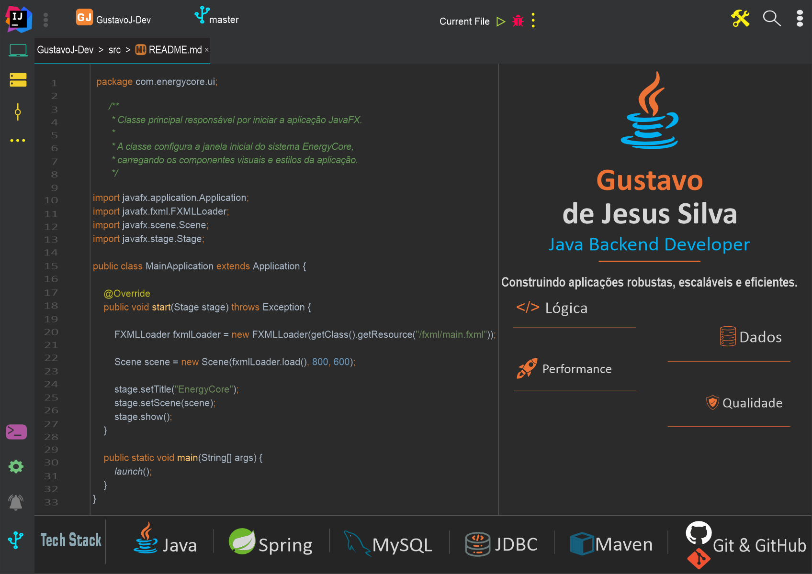

  

<h1 align="center">Olá! Eu sou Gustavo Silva 👋</h1>

  

Sou estudante de **Análise e Desenvolvimento de Sistemas** e desenvolvedor Java em formação, com foco em **Backend**. Tenho mais de um ano de prática com Java por meio de projetos acadêmicos e pessoais, nos quais venho desenvolvendo aplicações e aprofundando meus conhecimentos em Programação Orientada a Objetos, persistência de dados e organização de código.

Atualmente, direciono meus estudos ao ecossistema **Spring**, desenvolvendo projetos para consolidar conhecimentos em APIs REST, arquitetura em camadas, bancos de dados, validação e qualidade de código. Busco minha primeira oportunidade profissional na área de desenvolvimento, onde possa contribuir, aprender com outros profissionais e evoluir continuamente.

---

## 🚀 Languages and Tools

  

  
  
  
  
  
  
  
  
  

**Java:** Java Core, Programação Orientada a Objetos, Collections Framework, Generics, Streams API, Lambda Expressions, Multithreading, Java I/O e NIO, Date and Time API, Regular Expressions.

**Backend e bancos de dados:** Spring Boot, Spring Data JPA, Hibernate, JPA, JPQL, CriteriaBuilder, JDBC, SQL, MySQL, H2, APIs REST, Bean Validation e Maven.

**Outros conhecimentos e ferramentas:** JavaFX, FXML, CSS, HTML5, CSS3, JavaScript, Networking (Sockets, TCP/UDP e WebSocket), JUnit 5, Mockito, JaCoCo, MapStruct, Lombok, Docker Compose, Git e GitHub.

---

## 🤝 Let's connect!

  
  
  
  

---

## 📌 Featured Repositories

### ⚡ [PowerManager API](https://github.com/GustavoJ-dev/PowerManager)
**Backend de gerenciamento de energia e faturamento | Java 21 · Spring Boot · JPA · Hibernate · MySQL · Docker Compose · JUnit 5 · Mockito**

API REST desenvolvida para organizar o gerenciamento de clientes, medidores, tarifas, faturas e usuários. O projeto aplica arquitetura em camadas, com entidades JPA, repositórios e serviços responsáveis pelas regras de negócio, validações e tratamento de exceções. Também conta com testes unitários utilizando JUnit 5 e Mockito, com **100% de cobertura reportada na camada de serviços**.

### ☕ [JavaStudiesHub](https://github.com/GustavoJ-dev/JavaStudiesHub)
**Central de estudos e projetos práticos em Java | Java Core · POO · Collections · Generics · Lambdas · Streams API · Git · GitHub**

Repositório estruturado em **18 módulos**, reunindo mais de **40 exercícios práticos** e aproximadamente **10 mini projetos**. Abrange desde os fundamentos da linguagem até conceitos de Programação Orientada a Objetos, Collections Framework, Generics, Lambdas e Streams API. Inclui materiais de apoio e exemplos práticos, organizados para documentar e acompanhar a evolução contínua dos estudos em Java.

### 🧮 [Scientific Calculator](https://github.com/GustavoJ-dev/ScientificCalculator)
**Aplicação desktop de cálculos matemáticos | Java 21 · JavaFX · FXML · CSS · Maven**

Calculadora desktop desenvolvida com JavaFX, oferecendo modos **simples e científico** e um conjunto de **14 operações matemáticas**. Possui estado compartilhado entre as interfaces e tratamento de situações inválidas, como divisão por zero, raiz quadrada de números negativos e logaritmos com entradas inválidas. O projeto reforça a aplicação de JavaFX, organização por interfaces e lógica de programação.

### 💼 [Java Portfolio](https://github.com/GustavoJ-dev/Java-Portfolio)
**Portfólio pessoal de desenvolvimento | HTML5 · CSS3 · JavaScript**

Site desenvolvido para apresentar minha trajetória na área de tecnologia, competências técnicas e projetos. Construído com HTML, CSS e JavaScript, possui identidade visual inspirada no tema Darcula e layout responsivo, reunindo em um só lugar informações sobre minha atuação e evolução como desenvolvedor.

---

## 📄 Currículo

Confira meu currículo completo com minha trajetória, conhecimentos e projetos.

👉 [**Visualizar currículo em PDF**](./Gustavo%20de%20Jesus%20Silva%20-%20Desenvolvedor%20Java%20j%C3%BAnior.pdf)

---

## 📊 GitHub Stats

  
  

  

